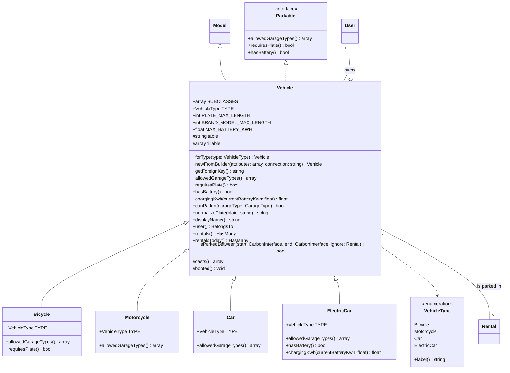

# Class diagram

Drawn from the code, following CLAUDE.md section 12: controllers, models, class-based components and
the interface they realise; no views. Laravel's own parents are name-only boxes. The full diagram
(controllers and the other models) is completed in the documentation batch.

## Vehicle hierarchy (single-table inheritance on `vehicles.type`)

| OOP principle | Where it shows |
|---|---|
| Inheritance | `Bicycle`, `Motorcycle`, `Car`, `ElectricCar` extend `Vehicle`, which extends Eloquent `Model` |
| Polymorphism | Each child overrides `allowedGarageTypes()` / `requiresPlate()` / `hasBattery()`; `ElectricCar` overrides `chargingKwh()`, so `Rental` asks any vehicle the same question without checking its class |
| Abstraction | `Parkable` states what every parkable thing must answer; callers use `canParkIn()` without knowing the type |
| Encapsulation | `type` is not mass-assignable: the class sets it (`forType()`, the child's `TYPE`), so a car can never be stored as a bicycle |
| Open/Closed | A new vehicle type = a new child class + one `SUBCLASSES` entry, without editing the rental code |
