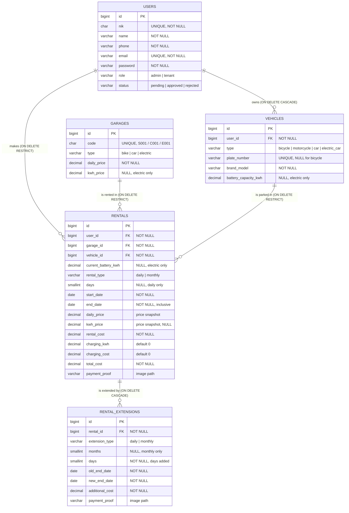

# ERD - Garage rental

Source of truth for the schema; the migrations must match it exactly. The same diagram is kept raw in `erd.mmd`.
Column details and business rules: `database-structure.md`. Every table also has `created_at` / `updated_at`.

## Relationships

| Relationship | Cardinality | Foreign key | ON DELETE | Why |
|---|---|---|---|---|
| User owns Vehicle | 1 : N | `vehicles.user_id` | CASCADE | A vehicle has no meaning without its owner |
| User makes Rental | 1 : N | `rentals.user_id` | RESTRICT | Rental history must be kept |
| Garage is rented in Rental | 1 : N | `rentals.garage_id` | RESTRICT | A garage with rentals cannot disappear |
| Vehicle is parked in Rental | 1 : N | `rentals.vehicle_id` | RESTRICT | Rentals keep their vehicle (no copied vehicle details) |
| Rental is extended by RentalExtension | 1 : N | `rental_extensions.rental_id` | CASCADE | An extension has no meaning without its rental |
| User rents Garage | M : N | through `rentals` | | |

## Constraints

| Table | Constraint |
|---|---|
| users | `nik` UNIQUE (16 digits), `email` UNIQUE |
| garages | `code` UNIQUE (S/C/E + 3 digits) |
| vehicles | `plate_number` UNIQUE, NULL only for bicycles |
| rentals | index `(garage_id, start_date, end_date)`, index `(vehicle_id, start_date, end_date)` |
